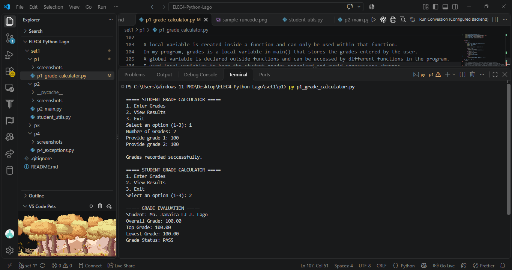
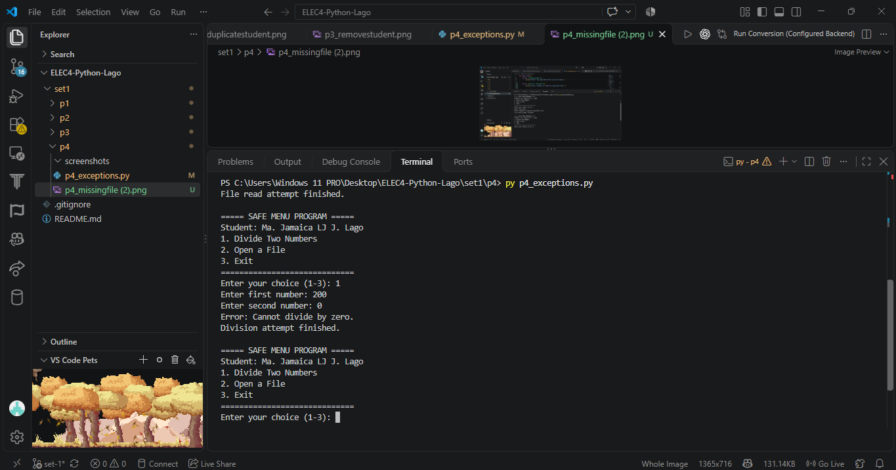

# ELEC 4 – Python Programming

**Student:** Ma. Jamaica LJ J. Lago  
**Section:** IV-BSIT A  
**Course:** ELEC 4 – Python Programming  
**Set:** Set 1 (P1–P4)

## About This Repository

This repository contains my individual Python programming activities for Set 1.

The activities demonstrate functions, modules, lists and sets, and exception handling.

## Set 1 Activities

| Activity | Description | Activity Folder |
|---|---|---|
| P1 – Student Grade Calculator | A menu-driven calculator that validates grades and displays the average, highest grade, lowest grade, and pass/fail status. | [P1](set1/p1/) |
| P2 – Custom Module: student_utils | A student grade report that uses a custom module, two import styles, and the built-in datetime module. | [P2](set1/p2/) |
| P3 – Student Record Manager | A menu-driven manager that uses a list and a set to add, search, remove, and display students while preventing duplicates. | [P3](set1/p3/) |
| P4 – Safe Menu Program | A program that demonstrates exception handling for division, file reading, and invalid menu selections. | [P4](set1/p4/) |

## How to Run

Make sure Python is installed on your computer.

Open a terminal in the root folder of this repository.

### P1 – Student Grade Calculator
```bash
python set1/p1/p1_grade_calculator.py
```

### P2 – Custom Module
```bash
python set1/p2/p2_main.py
```

### P3 – Student Record Manager
```bash
python set1/p3/p3_record_manager.py
```

### P4 – Safe Menu Program
```bash
python set1/p4/p4_exceptions.py
```

**Note:** Run each command separately. On some systems, use `python3` instead of `python`.

## Screenshots

### P1 – Student Grade Calculator


### P2 – Custom Module


### P3 – Student Record Manager


### P4 – Safe Menu Program


Additional screenshots for each activity are located in that activity's screenshots folder.
