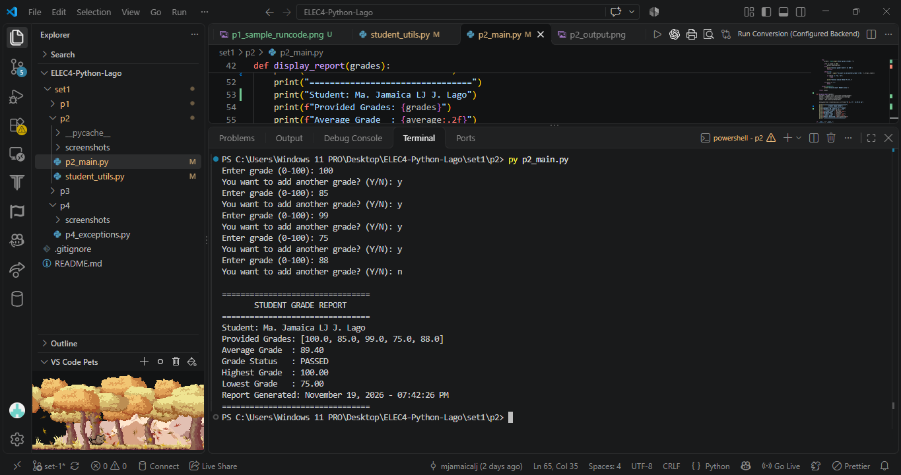
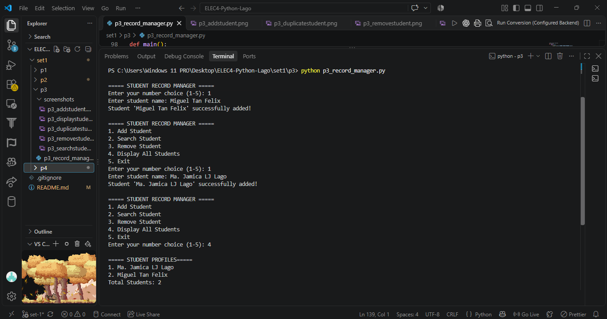
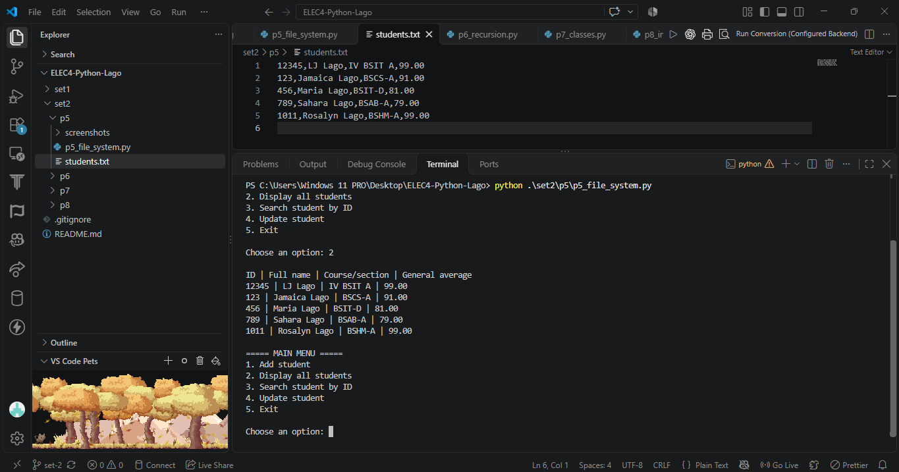
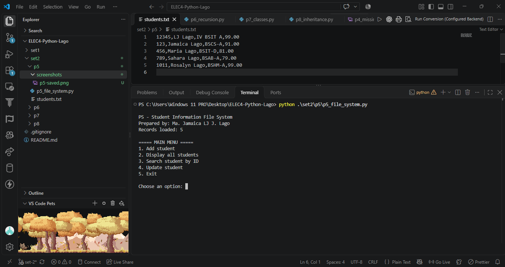
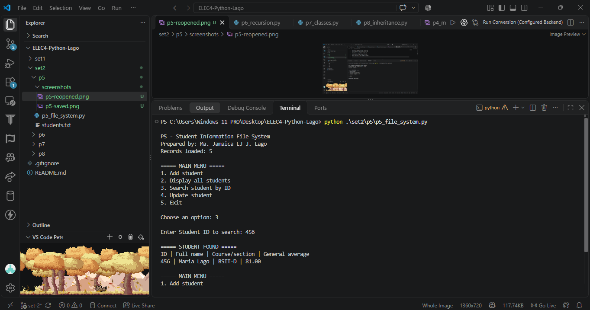
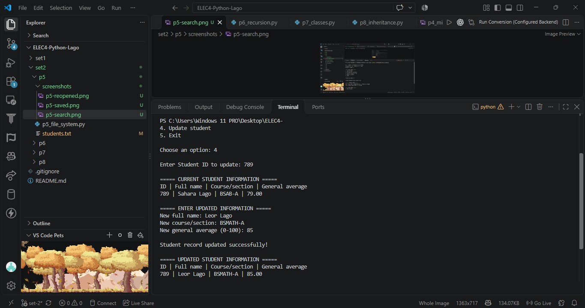
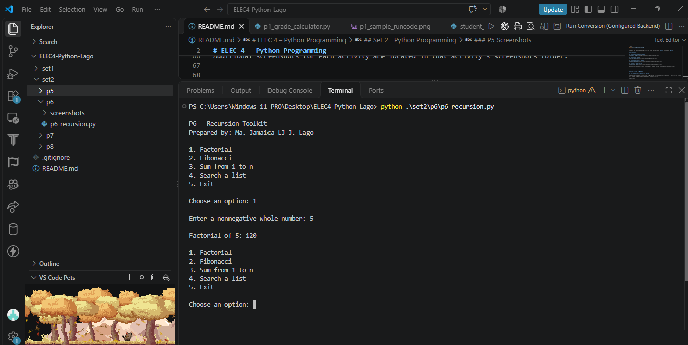
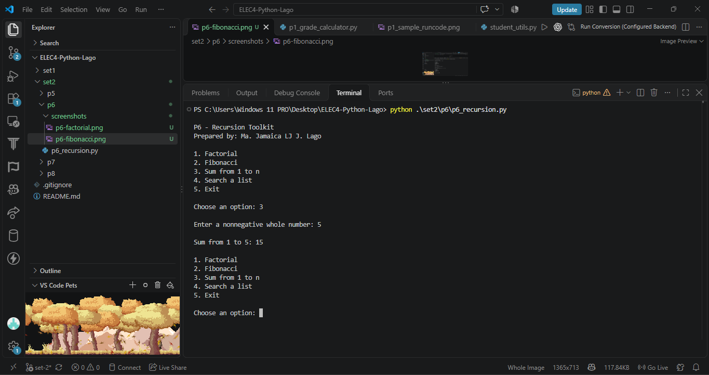
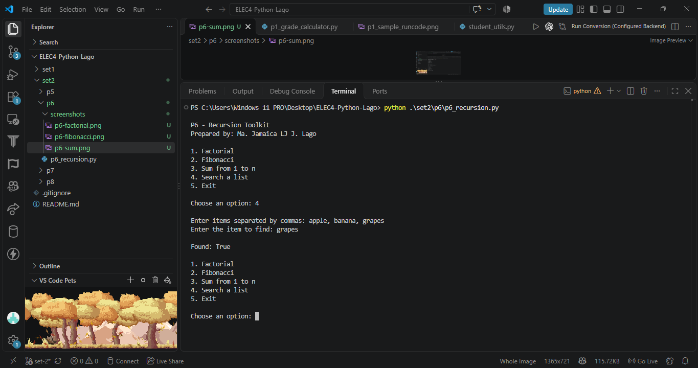
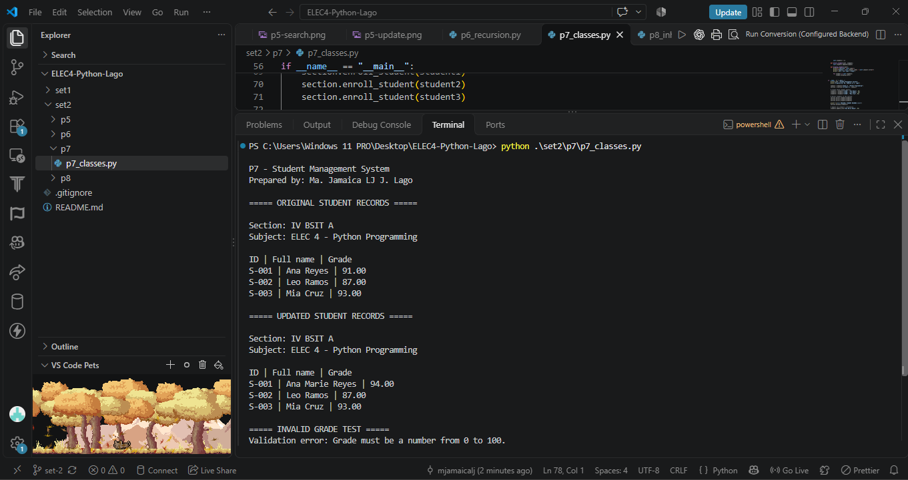

# ELEC 4 – Python Programming

**Student:** Ma. Jamaica LJ J. Lago  
**Section:** IV-BSIT A  
**Course:** ELEC 4 – Python Programming  
**Set:** Set 1 (P1–P4)

## About This Repository

This repository contains my individual Python programming activities for Set 1.

The activities demonstrate functions, modules, lists and sets, and exception handling.

## Set 1 Activities

| Activity | Description | Activity Folder |
|---|---|---|
| P1 – Student Grade Calculator | A menu-driven calculator that validates grades and displays the average, highest grade, lowest grade, and pass/fail status. | [P1](set1/p1/) |
| P2 – Custom Module: student_utils | A student grade report that uses a custom module, two import styles, and the built-in datetime module. | [P2](set1/p2/) |
| P3 – Student Record Manager | A menu-driven manager that uses a list and a set to add, search, remove, and display students while preventing duplicates. | [P3](set1/p3/) |
| P4 – Safe Menu Program | A program that demonstrates exception handling for division, file reading, and invalid menu selections. | [P4](set1/p4/) |

## How to Run

Make sure Python is installed on your computer.

Open a terminal in the root folder of this repository.

### P1 – Student Grade Calculator
```bash
python set1/p1/p1_grade_calculator.py
```

### P2 – Custom Module
```bash
python set1/p2/p2_main.py
```

### P3 – Student Record Manager
```bash
python set1/p3/p3_record_manager.py
```

### P4 – Safe Menu Program
```bash
python set1/p4/p4_exceptions.py
```

**Note:** Run each command separately. On some systems, use `python3` instead of `python`.

## Screenshots

### P1 – Student Grade Calculator


### P2 – Custom Module


### P3 – Student Record Manager


### P4 – Safe Menu Program


Additional screenshots for each activity are located in that activity's screenshots folder.


## Set 2 - Python Programming

### P5 - Student Information File System

**Description:** A menu-driven Python program that stores student information in a text file. It allows users to add, display, search, and update student records.

**Features:**
- Add new student records
- Display all student records
- Search students by ID
- Update student information
- Save and load records using students.txt
- Handle invalid input and missing files

**How to Run:**

`python set2/p5/p5_file_system.py`

**Activity Folder:** [P5 File System](set2/p5/)

### P5 Screenshots

**1. Saved Student Records**



**2. Reopened Student Records**



**3. Search Student by ID**



**4. Update Student Information**




### P6 - Recursion Toolkit

**Description:** A menu-driven Python program that demonstrates four recursive functions using base cases and recursive calls.

**Features:**
- Calculate factorial of a number
- Find the nth Fibonacci number and display the first n terms
- Calculate the sum from 1 to n
- Search for a target in a list recursively

**How to Run:**

`python set2/p6/p6_recursion.py`

**Activity Folder:** [P6 Recursion Toolkit](set2/p6/)

### P6 Screenshots

**1. Factorial**



**2. Fibonacci**


**3. Summation**



**4. Recursive Search**




### P7 - Student Management System with Classes

**Description:** A Python program that demonstrates object-oriented programming using Student, Subject, and Section classes.

**Features:**
- Create and display three student objects
- Organize students using Subject and Section classes
- Update student information and grades
- Use a private grade attribute with getter and setter methods
- Validate grades from 0 to 100
- Display student records before and after updating

**How to Run:**

`python set2/p7/p7_classes.py`

**Activity Folder:** [P7 Student Management System](set2/p7/)

### P7 Screenshot


